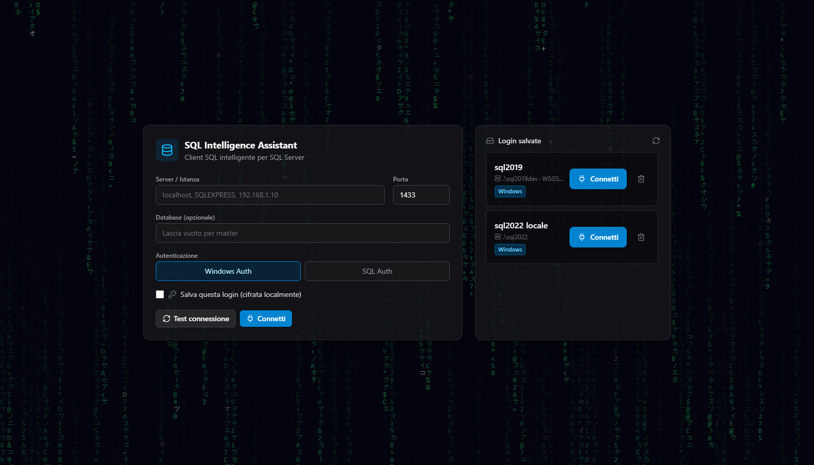
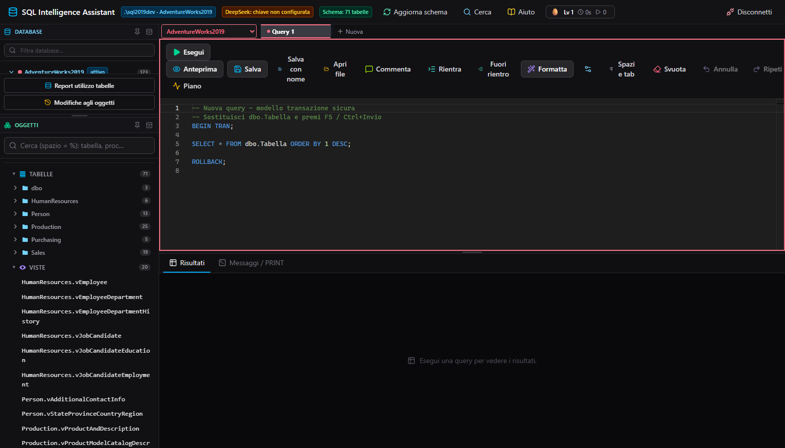
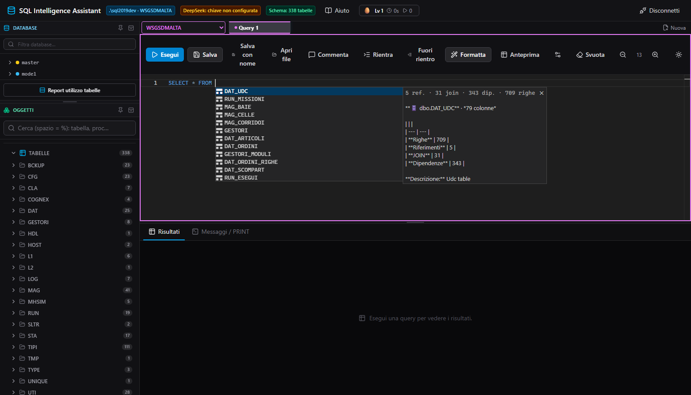
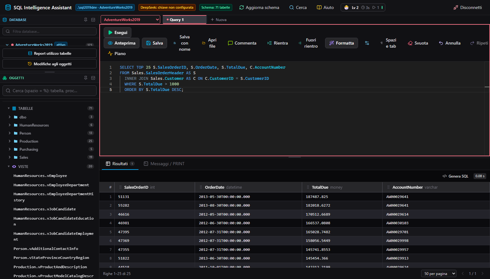
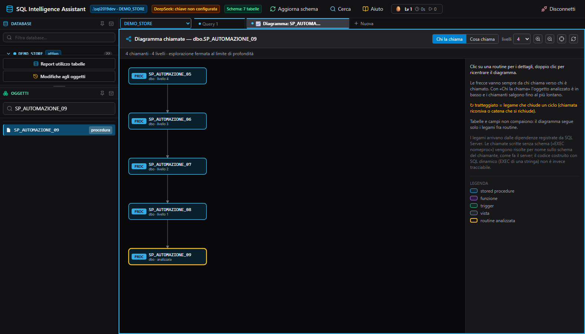

# SQL Intelligence Assistant

Client SQL nel browser con **intellisense consapevole dello schema**, formattatore T-SQL, generatore di
statement dai risultati, **diagramma delle chiamate fra routine** e assistente IA opzionale.

- **Backend**: ASP.NET Core Web API (.NET 10) + `Microsoft.Data.SqlClient`
- **Frontend**: React + Vite + TypeScript, Tailwind CSS 4, Monaco Editor (bundle locale, nessun CDN)
- **IA**: completamento inline con API **DeepSeek** (opzionale), con lo schema del database come contesto
- **Database**: SQL Server (testato su database reali di produzione, con centinaia di tabelle e
  oltre un migliaio di stored procedure per database)

**🇮🇹 Italiano** · [🇬🇧 English](#-english)

---

## Screenshot

| | |
|---|---|
|  |  |
| **Login** — credenziali Windows o SQL, login salvate | **Editor e albero oggetti** — schema reale in sidebar |
|  |  |
| **Intellisense** — suggerimenti per contesto | **Risultati** — numero di riga, linee, 3 colori, colonne spostabili |
|  | |
| **Diagramma chiamate** — chi chiama una routine, fino al chiamante più lontano (cicli segnalati) | |

Gli screenshot si rigenerano con `node scripts/capture-screenshots.mjs` (backend e dev server attivi):
pilota Chrome headless via CDP e salva i PNG in `docs/screenshots/`.

---

## Funzionalità

### Connessione e sessioni

- Login con **Windows Auth** o **SQL Auth**: server, porta, database, test della connessione ed elenco dei
  database disponibili.
- **Login salvate** in SQLite locale, con password cifrata (DPAPI, ambito utente); si riusano al riavvio.
- **Cambio database** dalla combo in alto o cliccando un database nella sidebar.
- **Un colore per database** (persistito): la combo e il bordo delle tab lo usano, per non sbagliare
  database quando ne hai aperti più di uno.
- Le connection string delle sessioni attive vivono **solo in memoria** e non vengono mai restituite al client.

### Editor SQL

- **Multi-tab**: più query aperte, ripristinate al riavvio. Trascina per riordinare, **puntina** per
  appuntare (restano in testa e non si chiudono), X per chiudere. La nuova tab si apre **subito dopo
  quella attiva**, non in fondo.
- **Icona/emoji per tab** (⭐ 🐞 ⚠️ …) più titolo e descrizione libera, dal tasto destro sulla tab.
- **Tante tab? Tasto destro e "»"**: chiusura in blocco stile SSMS (tutte le altre, a destra, a sinistra,
  tutte le non appuntate — le appuntate sono protette). Le tab riempiono la riga e poi vanno a capo; se non
  bastano le righe disponibili compare il pulsante "»" con l'elenco completo.
- **Tab figlie**: un oggetto aperto da un link o da "Modifica" nasce **figlio** della tab attiva e va a capo
  su una riga **sotto la madre** (rientrato, con la freccia come marcatore), fino a 5 livelli. Trascinando
  una tab fuori dal gruppo la si stacca e torna principale; chiudendo una madre con figlie l'app chiede se
  chiudere anche loro.
- **Esecuzione**: F5 / Ctrl+Invio esegue lo statement corrente (o solo la selezione, come SSMS); più batch
  separati da `GO`, cattura dei `PRINT`, più result set.
- **File .sql**: trascina i file nell'app o usa "Apri file"; **Salva** (Ctrl+S) sovrascrive l'originale,
  **Salva con nome** (Ctrl+Shift+S) sceglie dove.
- **Zoom** con Ctrl+rotella e **tema** chiaro/scuro su tutta la pagina.
- **Formattatore T-SQL** (Ctrl+Shift+F) con profilo configurabile: pannello impostazioni, import/export di
  `formatprofile.xml`; formattazione **idempotente** e che non perde un solo token.
- **Selezione della parola** con doppio clic che comprende i prefissi T-SQL: `@var`, `@@ROWCOUNT`, `#tmp`,
  `##globale`.

### Intellisense e autocompletamento

- **Suggerimenti per contesto**: dopo `FROM`/`JOIN` solo tabelle, viste e **funzioni tabellari**; dopo
  `EXEC` solo stored procedure; nella select-list e in `WHERE`/`ON`/`GROUP BY`/`ORDER BY` solo colonne e
  funzioni (nella `ORDER BY` le direzioni `ASC`/`DESC` compaiono solo dopo aver scelto un campo); dopo un alias (`r.`, `[r].`, `#tmp.`) le colonne qualificate di quella tabella — alias di
  tabelle, **temporanee** e **CTE** definite nel documento (`with c as (…) select * from c pippo where pippo.`).
- **Mai popup vuoto** in posizione di codice: se lo schema non è disponibile (sessione scaduta) propone
  comunque snippet, funzioni e keyword, e ricarica i metadati da solo.
- **Aggiorna schema** (pulsante in alto o **Ctrl+Shift+R**, come il *Refresh* di SSMS): rilegge tabelle,
  colonne, viste e routine dal database saltando la cache del backend, così dopo aver creato o modificato
  oggetti altrove l'intellisense e l'albero laterale usano subito la versione nuova (e il diagramma delle
  chiamate viene ricaricato).
- **JOIN intelligenti**: dopo `FROM t JOIN ` propone le tabelle collegate da **foreign key** con la clausola
  `ON` già compilata (una voce per vincolo, con alias brevi se la query usa alias). Le altre sono ordinate
  per **utilizzo reale** nel database (FK entrante/uscente, dipendenze, righe stimate) e per co-occorrenza
  nei JOIN delle stored procedure.
- **Controparti e condizioni**: scrivendo `mis_d_cella = ` propone `cel_cella`; dentro una `ON` con già una
  condizione propone le altre coppie dello stesso vincolo.
- **EXEC**: dopo `EXEC proc` suggerisce i parametri (tipo, IN/OUTPUT, default noti, tab-stop) ed esclude
  quelli già scritti; dal menu contestuale genera l'`EXEC` con i valori di default reali.
- **Parametri della routine in modifica**: mentre modifichi una store o una funzione, scrivendo `@` il popup
  propone i **parametri della firma** insieme alle variabili dichiarate (`DECLARE`); letti anche con lo stile
  `@param as tipo`, con i parametri fra parentesi su più righe, i valori di default e i commenti in mezzo.
- **Scrivere su più righe**: più cursori (`Ctrl+Alt+Giù/Su`, `Alt+clic`, `Ctrl+D`) — quello che scrivi va su
  tutti i cursori e incollando più righe il testo si distribuisce — oppure **selezione a blocchi** stile SSMS
  (`Alt+C` o l'interruttore "Scrittura su più righe"): si trascina un rettangolo e si scrive su tutte le righe
  selezionate. La preferenza è salvata.
- **INSERT**: dentro `INSERT INTO tab (` suggerisce le colonne (con "tutte le colonne"); dentro `VALUES`
  propone i valori di default per la colonna corrente, **evidenziando la coppia colonna↔valore**.
- **Campo corrispondente**: con il cursore su un campo si illumina quello abbinato — colonna ↔ valore negli
  `INSERT`, colonna ↔ espressione nella `SET` di un `UPDATE`, e in una `MERGE` i valori della `USING` ↔ le
  colonne di `src`, le coppie `a = b` della `SET` (ramo `MATCHED`) e della `ON`, e colonne ↔ valori
  dell'`INSERT` del ramo `NOT MATCHED`.
- **Espansione `*`**: il suggerimento "— tutti i campi (N) —" sostituisce l'asterisco con l'elenco completo
  delle colonne (campi univoci senza prefisso, condivisi qualificati).
- **Snippet di statement**: `ins`/`sel`/`upd`/`del`/`mer` a inizio statement aprono il template con tab-stop.
- **Parentesi intelligenti**: gli identificatori si inseriscono senza `[parentesi]` quando non servono.
- **Tabella temporanee e variabili tabella**: `#tmp` e `@tab` definite nel documento entrano nell'ambito
  (da `CREATE TABLE #t`, `DECLARE @t TABLE`, `SELECT ... INTO #t`, `INSERT INTO #t`). Per `SELECT … INTO #t`
  le colonne si ricavano dalla select-list (anche con `TOP n *`, alias di funzione e alias per posizione tipo
  `SCO_GIAC + SCO_VER X_GIAC`) e, con `*`, dalla sorgente: tabella dello schema, altra temporanea o **CTE**
  definita nel testo.
- **Alias delle tabelle** e **label di GOTO**: dopo `GOTO ` vengono proposte tutte le label del
  documento (anche quelle definite più sotto, ignorando quelle nel codice commentato).
- **Errori in stile SSMS**: numero/livello/stato, procedura e riga; doppio clic sul messaggio →
  il cursore va sulla riga che ha fallito (per gli errori dentro una procedura la riga viene
  riportata sulla definizione aperta nella tab), e i pulsanti aprono gli oggetti citati.
- **Cronologia d'uso**: tabelle e colonne che usi di più pesano di più nel ranking.
- **Diagnostica in tempo reale**: parentesi/apici non bilanciati e colonne qualificate inesistenti
  vengono sottolineati mentre scrivi (senza eseguire nulla).
- **Colori per tabella**: ogni tabella ha un colore stabile e le sue colonne lo condividono; le colonne
  ambigue restano non colorate.
- **Autocompletamento IA** (opzionale): con il toggle attivo, dopo una breve pausa DeepSeek propone il
  proseguimento della query usando lo schema come contesto.

### Sidebar (albero oggetti) e scripting

- Albero **stile SSMS**: database, tabelle raggruppate per prefisso (con colonne e trigger annidati), viste
  e programmabilità (stored procedure, funzioni, trigger orfani), vincoli CHECK.
- **Click** su un oggetto per inserirne il nome qualificato nell'editor; **hover** su una tabella per
  proprietà estese, metriche d'uso e **anteprima delle prime 30 righe**; hover su una colonna per tutte le
  proprietà estese.
- **Tasto destro stile SSMS**: per le tabelle "Seleziona le prime 1000 righe" e gli script per ogni
  operazione (CREATE, DROP, SELECT, INSERT, UPDATE, DELETE, MERGE); per procedure/funzioni/viste/trigger
  "Modifica" (CREATE OR ALTER), "Apri definizione", "Script" ed **EXEC con parametri**.
- **Ricerca** su tabelle, viste, procedure, funzioni e trigger (gli spazi valgono come `%`).
- **Ricerca generale** (pulsante "Cerca" in alto, stile Redgate SQL Search): un testo qualunque cercato
  nei **nomi** e nelle **definizioni** delle strutture (tabelle, viste, routine, vincoli, colonne
  calcolate) e — con "anche nei dati" — nei **valori** delle colonne di testo. Risultati sopra e
  **anteprima sotto** (script con il match evidenziato e la riga trovata, colonne della tabella, riga di
  dati trovata). Da un risultato su procedura/funzione/vista/trigger si può **modificare** l'oggetto
  (pulsante "Modifica", doppio clic o tasto destro → menu: CREATE OR ALTER in una tab, figlia di quella
  attiva; più "Apri definizione" e "Diagramma chiamate"). Resta dentro il **database attivo** e la
  scansione dei dati è limitata (tabelle, tempo, righe per tabella) per non appesantire il database.
- **Report utilizzo tabelle**: spazio riservato/usato, righe, indici, accessi.
- **Modifiche agli oggetti**: la finestra con la griglia di store, funzioni, viste, tabelle e trigger e
  **quando** sono stati modificati (giorno e ora dell'ultima modifica, più la creazione e il "quanto fa" in
  italiano). Ordinabile per colonna, con filtri per nome, tipo e periodo (24 ore / 7 / 30 giorni); doppio
  clic su una riga per aprire l'oggetto e modificarlo. Le date sono quelle di SQL Server (`sys.objects`):
  per oggetto c'è l'ultima modifica, non lo storico.

### Diagramma delle chiamate

- Tasto destro su una **stored procedure o una funzione** (nell'albero **o dentro l'editor**, sul nome nel
  codice) → **"Diagramma chiamate"**: i legami con le altre routine, **salendo fino al chiamante più
  lontano** (o scendendo verso quello che chiama).
- **Cicli e ricorsioni gestiti**: le routine che chiamano se stesse e le catene che si richiudono sono
  segnalate con ↻ e tratteggiate, non fanno mai esplodere il disegno. Ogni routine viene espansa una sola
  volta, con limiti di profondità e numero di nodi segnalati a video.
- **Legami da SQL Server**: dipendenze reali (`sys.sql_expression_dependencies`), incluse le **chiamate
  scritte senza schema** (`EXEC nomeproc`), risolte per nome sullo schema del chiamante.
- Interazione: clic per i dettagli, **doppio clic per ricentrare**, zoom e trascinamento, e da lì si apre la
  definizione in una nuova tab (CREATE OR ALTER).

### Risultati e generatore di statement

- **Griglia risultati**: numero di riga nella prima colonna (con la casella di selezione **fissa a
  sinistra** mentre si scorre), **linea verticale fra le colonne**, righe **alternate a gruppi di tre
  colori**, paginazione (25/50/100/200), più result set, badge di troncamento, tempi di esecuzione.
- **Colonne spostabili** trascinando l'intestazione: cambia solo la vista, mentre selezione e SQL generato
  seguono l'ordine originale.
- **Generatore SQL dai risultati**: seleziona righe e colonne e genera `INSERT`, `UPDATE`, `MERGE`,
  `DELETE` o `INSERT INTO #tmp` (la tabella target è proposta dal SQL eseguito ed è modificabile).
  Nella `MERGE` la chiave è la **primary key** della tabella (anche composita) e i **campi chiave non
  finiscono mai nell'`UPDATE SET`**: restano solo nella condizione `ON` (e nell'`INSERT`); se la chiave
  copre tutte le colonne la clausola `WHEN MATCHED THEN UPDATE` non viene scritta.
- **Tab Stampa** con la versione pronta per la stampa di risultati e messaggi.

### Gamification del lavoro

- Ogni tab raccoglie **tempo di lavoro, numero di esecuzioni, errori**, con **XP e livelli** (🥚 → 🏆),
  barra di avanzamento, grafico degli esiti e istogramma degli ultimi 14 giorni, medaglie e serie di giorni.

### Aiuto integrato

- Guida in-app con tutte le funzioni e l'elenco delle scorciatoie (F5/Ctrl+Invio, Ctrl+S, Ctrl+Shift+S,
  Ctrl+Shift+F, Ctrl+Shift+R, Ctrl+R, Ctrl+Spazio, Ctrl+rotella).

---

## Architettura

```
HarnessSqlComplete/
├── backend/SqlIntelliBackend/     # ASP.NET Core Web API (.NET 10)
│   ├── Controllers/               # connections, metadata, query, autocomplete
│   ├── Services/                  # ConnectionHub, MetadataService/Cache, QueryService, DeepSeekService, ...
│   ├── Models/                    # DTO
│   └── Data/                      # AppDbContext (SQLite per le login salvate)
├── frontend/                      # Vite + React + TypeScript + Tailwind 4
│   ├── src/
│   │   ├── components/            # LoginScreen, Sidebar, SqlEditor, ResultsPanel, CallGraphModal, ...
│   │   ├── sqlCompletions.ts      # provider di completamento (eseguito dai test)
│   │   ├── tsqlFormatter.ts       # formattatore T-SQL per profili
│   │   ├── callGraph.ts           # grafo delle chiamate: esplorazione e layout (logica pura)
│   │   ├── resultGrid.ts          # griglia: riordino colonne e righe alternate
│   │   └── __tests__/             # 75 file di test (873 test)
│   └── scripts/                   # generatori di fixture dai database reali
├── scripts/                       # strumenti di progetto (screenshot, riparazione codifica)
└── docs/                          # documentazione e screenshot
```

---

## Requisiti e avvio

Requisiti: [.NET SDK 10](https://dotnet.microsoft.com/download), [Node.js 20+](https://nodejs.org),
un'istanza SQL Server raggiungibile (locale o di rete).

```bash
# 1. backend → http://localhost:5213
cd backend/SqlIntelliBackend && dotnet run

# 2. frontend → http://localhost:5173  (Vite inoltra /api al backend)
cd frontend && npm install && npm run dev
```

Su Windows c'è anche uno script che avvia (o ferma) entrambi in due finestre:

```powershell
.\scripts\start-app.ps1          # avvia backend + app e apre il browser
.\scripts\start-app.ps1 -Stop    # ferma i due server
```

**Chiave DeepSeek (opzionale)** per l'autocompletamento IA, in
`backend/SqlIntelliBackend/appsettings.json`:

```json
"DeepSeek": { "ApiKey": "sk-...", "Model": "deepseek-chat" }
```

oppure con la variabile d'ambiente `DEEPSEEK__APIKEY`. Senza chiave l'editor funziona normalmente con il
completamento basato sullo schema.

---

## Verifica e test

```bash
cd frontend
npm run build     # type-check reale (tsc -b) + bundle di produzione
npm test          # 873 test in 75 file
```

I test girano su **dati reali**, non solo su esempi scritti a mano:

- `realSchema.test.ts` e `realDefinitions.test.ts` usano lo **schema vero** di un database di produzione
  (286 tabelle, 260 funzioni di cui 81 tabellari, 400 FK, 138 trigger, 460 vincoli CHECK) e definizioni reali;
- `callGraph.test.ts` esplora il **grafo reale delle chiamate** (oltre 2200 legami) partendo da **ogni**
  routine del database, senza limiti di profondità, per dimostrare che i cicli non bloccano nulla;
- `completionSmoke.test.ts` esegue il provider di completamento **a ogni posizione** di diverse query e
  fallisce se lancia un'eccezione o se non propone nulla in posizione di codice;
- `resultsPanelGrid.test.tsx` e `resultGridDrag.test.tsx` montano la griglia in un DOM reale e **simulano il
  trascinamento** delle colonne;
- `encoding.test.ts` rilegge **tutti i sorgenti** e fallisce se ricompare testo con doppia codifica.

I fixture dei database reali si rigenerano con gli script in `frontend/scripts/`
(`makeSchemaFixture.mjs`, `makeDefinitionsFixture.mjs`, `makeCallGraphFixture.mjs`).

---

## API principali

| Metodo | Endpoint | Descrizione |
|---|---|---|
| `GET` | `/api/connections` | Elenco login salvate (senza password) |
| `POST` | `/api/connections/test` | Testa una connessione e restituisce i database disponibili |
| `POST` | `/api/connections/connect` | Si connette (con `save:true` salva la login) |
| `POST` | `/api/connections/saved/{id}/connect` | Connessione con una login salvata |
| `POST` | `/api/connections/{connectionId}/disconnect` | Chiude la sessione |
| `DELETE` | `/api/connections/{id}` | Elimina una login salvata |
| `POST` | `/api/connections/{connectionId}/switch-database` | Cambia il database della sessione |
| `GET` | `/api/metadata/{connectionId}/summary` | Metadati completi (cache 2 min): tabelle, colonne, viste, procedure con parametri, trigger, funzioni, vincoli CHECK, FK, metriche d'uso, proprietà estese |
| `GET` | `/api/metadata/{connectionId}/summary?refresh=true` | Come sopra, ma **ignora la cache** e rilegge tutto dal database (pulsante "Aggiorna schema" / Ctrl+Shift+R); invalida anche il grafo delle chiamate |
| `GET` | `/api/metadata/{connectionId}/tables/{schema}/{table}/columns` | Colonne di una tabella |
| `GET` | `/api/metadata/{connectionId}/tables/{schema}/{table}/preview?top=30` | Anteprima dati (`SELECT TOP n *`) |
| `GET` | `/api/metadata/{connectionId}/objects/{schema}/{name}/definition` | Definizione (testo) di proc/funzione/vista/trigger |
| `GET` | `/api/metadata/{connectionId}/routine-call-graph` | Legami fra routine (chi chiama chi), per il diagramma |
| `GET` | `/api/metadata/{connectionId}/search?q=` | Ricerca oggetti per nome |
| `GET` | `/api/metadata/{connectionId}/text-search?q=&data=` | Ricerca testuale generale (nomi, definizioni e, con `data=true`, valori nelle colonne di testo) |
| `GET` | `/api/metadata/{connectionId}/report/tables` | Report utilizzo tabelle (spazio, righe, indici, accessi) |
| `GET` | `/api/metadata/{connectionId}/changes` | Modifiche agli oggetti: creazione e ultima modifica (giorno e ora) di store, funzioni, viste, tabelle, trigger |
| `POST` | `/api/query/{connectionId}/execute` | Esegue SQL (multi-batch `GO`, `PRINT`, più result set) |
| `GET` | `/api/autocomplete/{connectionId}/status` | Stato della configurazione DeepSeek |
| `POST` | `/api/autocomplete/{connectionId}` | Suggerimento inline (SQL parziale + schema) |

---

## Note e limiti

- I legami del **diagramma** vengono dalle dipendenze registrate da SQL Server: il codice costruito con
  **SQL dinamico** (`EXEC` di una stringa) non è tracciabile e non compare. Le chiamate scritte **senza
  schema** vengono risolte per nome sullo schema del chiamante, come fa il server.
- Ogni result set è limitato a **5000 righe** (flag `truncated`), con paginazione lato client.
- Il batch SQL viene diviso sui separatori `GO`: un `GO` dentro una stringa letterale non è gestito.
- Le password salvate sono cifrate con DPAPI (`CurrentUser`); su piattaforme non Windows il fallback è
  Base64 (non sicuro, documentato nel codice).
- L'autocompletamento IA richiede una chiave DeepSeek; tutte le altre funzioni lavorano in locale.

## Licenza

Vedi [LICENSE.txt](LICENSE.txt).

---
---

# 🇬🇧 English

A browser-based SQL client with **schema-aware intellisense**, a T-SQL formatter, statement generation from
query results, a **routine call graph** and an optional AI assistant.

- **Backend**: ASP.NET Core Web API (.NET 10) + `Microsoft.Data.SqlClient`
- **Frontend**: React + Vite + TypeScript, Tailwind CSS 4, Monaco Editor (local bundle, no CDN)
- **AI**: inline completion through the **DeepSeek** API (optional), using the database schema as context
- **Database**: SQL Server (developed against real production databases with hundreds of tables and
  more than a thousand stored procedures each)

## Screenshots

| | |
|---|---|
|  |  |
| **Login** — Windows or SQL authentication, saved logins | **Editor and object tree** — live schema in the sidebar |
|  |  |
| **Intellisense** — context-aware suggestions | **Results** — row numbers, column lines, 3-colour rows, draggable columns |
|  | |
| **Call graph** — who calls a routine, up to the farthest caller (cycles flagged) | |

Regenerate them with `node scripts/capture-screenshots.mjs` (backend and dev server running): it drives
headless Chrome over CDP and writes the PNGs to `docs/screenshots/`.

## Features

### Connections and sessions

- **Windows** or **SQL** authentication, with connection test and the list of available databases.
- **Saved logins** in local SQLite with DPAPI-encrypted passwords (user scope).
- **Database switching** from the top combo or by clicking a database in the sidebar.
- **One colour per database** (persisted) used by the combo and by each tab border.
- Live connection strings stay **in memory only** and are never sent back to the client.

### SQL editor

- **Multi-tab** editing, restored on restart; drag to reorder, **pin** tabs (always first, not closable),
  close with X. A new tab opens **right after the active one**.
- **Per-tab icon/emoji** (⭐ 🐞 ⚠️ …) plus a free-text title and description, from the tab context menu.
- **Many tabs? Right-click and "»"**: SSMS-style bulk close (all others, to the right, to the left, all
  unpinned — pinned tabs are protected). Tabs fill the row and then wrap; when the available rows are not
  enough a "»" menu lists every open tab.
- **Child tabs**: an object opened from a link or from "Edit" is created as a **child** of the active tab
  and wraps onto a row **below its parent** (indented, arrow marker), up to 5 levels deep. Dragging a tab
  out of the group detaches it back to top level; closing a parent with children asks whether to close them too.
- **Run**: F5 / Ctrl+Enter runs the current statement, or just the selection, like SSMS; multiple `GO`
  batches, `PRINT` capture and multiple result sets.
- **.sql files**: drag files into the app or use "Open file"; **Save** (Ctrl+S) overwrites the original,
  **Save as** (Ctrl+Shift+S) picks a location.
- **Zoom** with Ctrl+wheel and a light/dark **theme** for the whole page.
- **T-SQL formatter** (Ctrl+Shift+F) with a configurable profile panel and import/export of
  `formatprofile.xml`; formatting is **idempotent** and never loses a token.
- **Double-click word selection** includes T-SQL prefixes: `@var`, `@@ROWCOUNT`, `#tmp`, `##globale`.

### Intellisense

- **Context-aware suggestions**: after `FROM`/`JOIN` only tables, views and **table-valued functions**;
  after `EXEC` only stored procedures; in the select list and in `WHERE`/`ON`/`GROUP BY`/`ORDER BY` only
  columns and functions (in `ORDER BY` the `ASC`/`DESC` directions appear only after a field is chosen); after an alias (`r.`, `[r].`, `#tmp.`) the qualified columns of that table — aliases
  of tables, **temp tables** and **CTEs** defined in the document (`with c as (…) select * from c pippo where pippo.`).
- **Never an empty popup** in a code position: with no schema available (expired session) it still offers
  snippets, functions and keywords, and reloads metadata on its own.
- **Refresh schema** (button in the header or **Ctrl+Shift+R**, like SSMS *Refresh*): re-reads tables,
  columns, views and routines from the database, bypassing the backend cache, so after creating or changing
  objects elsewhere the intellisense and the sidebar tree use the new version immediately (the call graph is
  reloaded too).
- **Smart JOINs**: after `FROM t JOIN ` it suggests tables linked by **foreign keys** with the `ON` clause
  already filled in (one entry per constraint, short aliases when the query uses aliases). Other tables are
  ranked by **real database usage** (incoming/outgoing FKs, dependencies, estimated rows) and by
  co-occurrence in stored procedure JOINs.
- **Counterparts and conditions**: typing `mis_d_cella = ` suggests `cel_cella`; inside an `ON` clause with
  one condition it suggests the other pairs of the same constraint.
- **EXEC**: after `EXEC proc` it suggests the parameters (type, IN/OUTPUT, known defaults, tab stops) and
  skips the ones you already typed; the context menu generates `EXEC` with the real default values.
- **INSERT**: inside `INSERT INTO tab (` it suggests the columns (plus "all columns"); inside `VALUES` it
  offers default values for the current column and **highlights the column↔value pair**.
- **Matching field highlight**: with the cursor on a field the paired one lights up — column ↔ value in
  `INSERT`s, column ↔ expression in an `UPDATE`'s `SET`, and inside a `MERGE` the `USING` values ↔ the `src`
  columns, the `a = b` pairs of the `SET` (`MATCHED` branch) and of the `ON`, and columns ↔ values of the
  `NOT MATCHED` `INSERT`.
- **`*` expansion**: the "— all fields (N) —" entry replaces the star with the full column list (unique
  fields unqualified, shared fields qualified).
- **Statement snippets**: `ins`/`sel`/`upd`/`del`/`mer` at statement start open a template with tab stops.
- **Multi-line writing**: multiple cursors (`Ctrl+Alt+Down/Up`, `Alt+click`, `Ctrl+D`) — what you type goes to
  every cursor and pasting several lines spreads them across cursors — or SSMS-style **block selection**
  (`Alt+C` or the "Scrittura su più righe" switch): drag a rectangle and type on every selected line. The
  preference is persisted.
- **Smart brackets**: identifiers are inserted without `[brackets]` when they are not needed.
- **Temp tables and table variables** defined in the document are in scope (`CREATE TABLE #t`,
  `DECLARE @t TABLE`, `SELECT ... INTO #t`, `INSERT INTO #t`). For `SELECT … INTO #t` the columns come from
  the select list (including `TOP n *`, function aliases and positional aliases like `SCO_GIAC + SCO_VER
  X_GIAC`) and, with `*`, from the source: a schema table, another temp table or a **CTE** defined in the text.
- **Table aliases** and **GOTO labels**: after `GOTO ` every label in the document is offered (including
  the ones defined further down; labels inside commented-out code are ignored).
- **SSMS-style errors**: number/level/state, procedure and line; double-clicking a message moves the
  cursor to the failing line (for errors inside a procedure the line is mapped onto the definition open
  in the tab), and the buttons open the objects named in the message.
- **Usage history**: tables and columns you use most rank higher.
- **Live diagnostics**: unbalanced brackets/quotes and unknown qualified columns are underlined as you
  type, without running anything.
- **Per-table colours**: each table has a stable colour shared by its columns; ambiguous columns stay plain.
- **Optional AI completion**: with the toggle on, DeepSeek proposes the continuation of the query after a
  short typing pause, using the schema as context.

### Object tree and scripting

- **SSMS-style tree**: databases, tables grouped by prefix (with nested columns and triggers), views,
  programmability (stored procedures, functions, orphan triggers) and CHECK constraints.
- **Click** an object to insert its qualified name into the editor; **hover** a table for extended
  properties, usage metrics and a **top-30-rows preview**; hover a column for all extended properties.
- **SSMS-style context menu**: tables get "Select top 1000 rows" plus scripts for every operation
  (CREATE, DROP, SELECT, INSERT, UPDATE, DELETE, MERGE); procedures/functions/views/triggers get
  "Modify" (CREATE OR ALTER), "Open definition", "Script" and **EXEC with parameters**.
- **Search** across tables, views, procedures, functions and triggers (spaces act as `%`).
- **Full-text search** ("Cerca" button in the header, Redgate SQL Search style): any text searched in
  object **names** and **definitions** (tables, views, routines, constraints, computed columns) and — with
  "anche nei dati" — in the **values** of text columns. Results on top and a **preview below** (script with
  the match highlighted and the matching line, table columns, matching data row). From a
  procedure/function/view/trigger result you can **edit** the object ("Modifica" button, double click or
  right-click menu: CREATE OR ALTER in a tab, child of the active one; plus "Apri definizione" and
  "Diagramma chiamate"). It stays inside the **active database**, and the data scan is bounded (tables,
  time, rows per table) to keep the database responsive.
- **Table usage report**: reserved/used space, rows, indexes, reads and writes.

### Call graph

- Right-click a **stored procedure or function** (in the tree **or in the editor**, on the name in the
  code) → **"Call graph"**: its links to other routines, **walking up to the farthest caller** (or down into
  what it calls).
- **Cycles and recursion are handled**: self-recursive routines and loops that close back are flagged with
  ↻ and dashed lines instead of blowing up the drawing. Each routine is expanded only once, with depth and
  node limits reported on screen.
- **Data straight from SQL Server**: real dependencies (`sys.sql_expression_dependencies`), including
  **calls written without a schema** (`EXEC procname`), resolved by name against the caller's schema.
- Interaction: click for details, **double-click to re-centre**, zoom and pan, and open the definition
  (CREATE OR ALTER) in a new tab from there.

### Results and statement generator

- **Results grid**: row number in the first column (with the selection checkbox **pinned to the left** while
  scrolling), a **vertical line between columns**, **rows alternating in groups of three colours**,
  pagination (25/50/100/200), multiple result sets, truncation badge and execution time.
- **Draggable columns**: drag a header to move it. This changes only the view — selection and generated SQL
  keep the original column order.
- **SQL generator from results**: select rows and columns and generate `INSERT`, `UPDATE`, `MERGE`,
  `DELETE` or `INSERT INTO #tmp` (the target table is inferred from the executed SQL and is editable).
  In a `MERGE` the key is the table's **primary key** (composite included) and **key columns never appear
  in the `UPDATE SET`**: they stay in the `ON` condition (and in the `INSERT`); when the key covers every
  column the `WHEN MATCHED THEN UPDATE` clause is omitted.
- **Print tab** with a print-ready rendering of results and messages.

### Work gamification

- Every tab tracks **working time, executions and errors**, with **XP and levels** (🥚 → 🏆), a progress bar,
  an outcome chart, a 14-day histogram, medals and day streaks.

### Built-in help

- In-app guide covering every feature and all keyboard shortcuts (F5/Ctrl+Enter, Ctrl+S, Ctrl+Shift+S,
  Ctrl+Shift+F, Ctrl+Shift+R, Ctrl+R, Ctrl+Space, Ctrl+wheel).

## Architecture

```
HarnessSqlComplete/
├── backend/SqlIntelliBackend/     # ASP.NET Core Web API (.NET 10)
│   ├── Controllers/               # connections, metadata, query, autocomplete
│   ├── Services/                  # ConnectionHub, MetadataService/Cache, QueryService, DeepSeekService, ...
│   ├── Models/                    # DTOs
│   └── Data/                      # AppDbContext (SQLite for saved logins)
├── frontend/                      # Vite + React + TypeScript + Tailwind 4
│   ├── src/
│   │   ├── components/            # LoginScreen, Sidebar, SqlEditor, ResultsPanel, CallGraphModal, ...
│   │   ├── sqlCompletions.ts      # completion provider (executed by tests)
│   │   ├── tsqlFormatter.ts       # profile-driven T-SQL formatter
│   │   ├── callGraph.ts           # call graph: traversal and layout (pure logic)
│   │   ├── resultGrid.ts          # grid: column reordering and zebra rows
│   │   └── __tests__/             # 75 test files (873 tests)
│   └── scripts/                   # fixture generators built from real databases
├── scripts/                       # project tooling (screenshots, encoding repair)
└── docs/                          # documentation and screenshots
```

## Requirements and setup

Requirements: [.NET SDK 10](https://dotnet.microsoft.com/download), [Node.js 20+](https://nodejs.org), and a
reachable SQL Server instance.

```bash
# 1. backend → http://localhost:5213
cd backend/SqlIntelliBackend && dotnet run

# 2. frontend → http://localhost:5173  (Vite proxies /api to the backend)
cd frontend && npm install && npm run dev
```

On Windows there is also a script that starts (or stops) both in two windows:

```powershell
.\scripts\start-app.ps1          # starts backend + app and opens the browser
.\scripts\start-app.ps1 -Stop    # stops both servers
```

**Optional DeepSeek key** for AI completion, in `backend/SqlIntelliBackend/appsettings.json`:

```json
"DeepSeek": { "ApiKey": "sk-...", "Model": "deepseek-chat" }
```

or via the `DEEPSEEK__APIKEY` environment variable. Without a key the editor still works with
schema-based completion.

## Verification and tests

```bash
cd frontend
npm run build     # real type-check (tsc -b) + production bundle
npm test          # 873 tests in 75 files
```

Tests run against **real data**, not only hand-written examples:

- `realSchema.test.ts` and `realDefinitions.test.ts` use the **real schema** of a production database
  (286 tables, 260 functions — 81 of them table-valued — 400 FKs, 138 triggers, 460 CHECK constraints) and
  real object definitions;
- `callGraph.test.ts` walks the **real call graph** (more than 2200 edges) starting from **every** routine
  in the database, with no depth limit, to prove that cycles never hang;
- `completionSmoke.test.ts` runs the completion provider **at every offset** of several queries and fails if
  it throws or returns nothing in a code position;
- `resultsPanelGrid.test.tsx` and `resultGridDrag.test.tsx` mount the grid in a real DOM and **simulate
  column dragging**;
- `encoding.test.ts` re-reads **every source file** and fails if double-encoded text reappears.

Fixture files built from real databases are regenerated with the scripts in `frontend/scripts/`.

## Main API

| Method | Endpoint | Description |
|---|---|---|
| `GET` | `/api/connections` | List saved logins (no passwords) |
| `POST` | `/api/connections/test` | Test a connection and list available databases |
| `POST` | `/api/connections/connect` | Connect (`save:true` stores the login) |
| `POST` | `/api/connections/saved/{id}/connect` | Connect with a saved login |
| `POST` | `/api/connections/{connectionId}/disconnect` | Close the session |
| `DELETE` | `/api/connections/{id}` | Delete a saved login |
| `POST` | `/api/connections/{connectionId}/switch-database` | Switch the session database |
| `GET` | `/api/metadata/{connectionId}/summary` | Full metadata (2-minute cache): tables, columns, views, procedures with parameters, triggers, functions, CHECK constraints, FKs, usage metrics, extended properties |
| `GET` | `/api/metadata/{connectionId}/summary?refresh=true` | Same as above but **skips the cache** and re-reads everything from the database ("Refresh schema" button / Ctrl+Shift+R); it also invalidates the call graph |
| `GET` | `/api/metadata/{connectionId}/tables/{schema}/{table}/columns` | Columns of a table |
| `GET` | `/api/metadata/{connectionId}/tables/{schema}/{table}/preview?top=30` | Data preview (`SELECT TOP n *`) |
| `GET` | `/api/metadata/{connectionId}/objects/{schema}/{name}/definition` | Definition text of a procedure/function/view/trigger |
| `GET` | `/api/metadata/{connectionId}/routine-call-graph` | Routine-to-routine links (who calls whom) for the diagram |
| `GET` | `/api/metadata/{connectionId}/search?q=` | Search objects by name |
| `GET` | `/api/metadata/{connectionId}/text-search?q=&data=` | Full-text search (names, definitions and, with `data=true`, values in text columns) |
| `GET` | `/api/metadata/{connectionId}/report/tables` | Table usage report (space, rows, indexes, reads/writes) |
| `POST` | `/api/query/{connectionId}/execute` | Execute SQL (multiple `GO` batches, `PRINT`, multiple result sets) |
| `GET` | `/api/autocomplete/{connectionId}/status` | DeepSeek configuration status |
| `POST` | `/api/autocomplete/{connectionId}` | Inline suggestion (partial SQL + schema) |

## Notes and limitations

- **Call graph** edges come from the dependencies SQL Server records: code built with **dynamic SQL**
  (executing a string) cannot be tracked and does not appear. Calls written **without a schema** are
  resolved by name against the caller's schema, exactly as the server does.
- Each result set is capped at **5000 rows** (the `truncated` flag), with client-side pagination.
- SQL batches are split on `GO` separators; a `GO` inside a string literal is not handled.
- Saved passwords are encrypted with DPAPI (`CurrentUser`); on non-Windows platforms the fallback is Base64
  (not secure, documented in the code).
- AI completion requires a DeepSeek key; everything else works locally.

## License

See [LICENSE.txt](LICENSE.txt).
